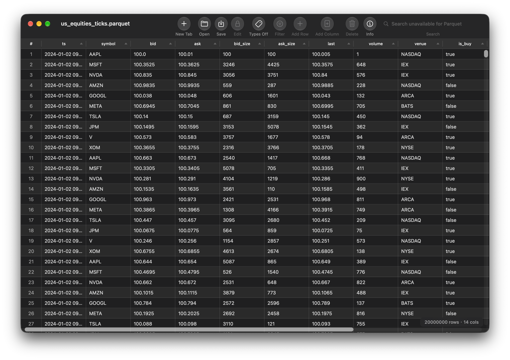
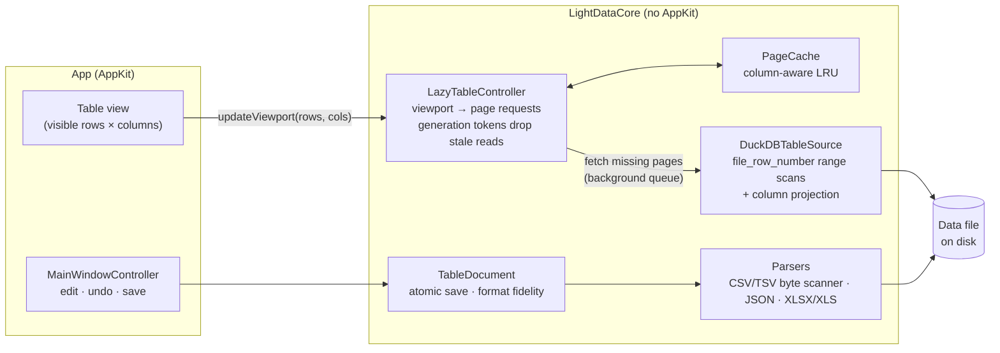

<div align="center">

# LightData

**A native macOS viewer for data files: CSV, TSV, JSON, Excel and Parquet files bigger than your RAM.**

Double-click a file and see it, without opening a notebook.

[](https://github.com/zyli04/lightdata/actions/workflows/ci.yml)


[](LICENSE)



</div>

## Why

People who work with data (quant researchers, data scientists, ML engineers) open data files all day. Most of the time the routine is: start Jupyter, run `pd.read_parquet(...)`, then `df.head()`, all just to look at a file. Spreadsheet apps choke on big files, and web tools need an upload.

LightData is the "Typora for data files". The file stays a plain local file, so Claude Code, Codex, scripts and pipelines can keep writing it. LightData just shows it, instantly and natively, and lets you make small edits safely.

## Highlights

- **Opens Parquet larger than memory.** Nothing is loaded whole. The grid asks only for its viewport, and LightData fetches just those rows and only the visible columns through DuckDB.
- **Instant open.** The row count is read from the Parquet footer, so even huge files don't trigger a full scan.
- **Fast, defensive CSV.** A byte-level parser auto-detects the delimiter. Seeded round-trip fuzzing and a corpus scanner guard the detection.
- **Edits you can trust.** Saves are atomic. LightData detects external changes, asks before you close or quit with unsaved edits, and keeps undo history across saves. Files whose types it can't round-trip open read-only.
- **Native.** Pure Swift and AppKit. No Electron, no account, nothing uploaded.

## Supported formats

| Format | View | Edit |
| --- | --- | --- |
| CSV / TSV | ✓ search, filter, sort | ✓ cells, rows, columns |
| JSON / JSONL (array of objects) | ✓ nested values flattened for display | ✓ only when every value is a string; otherwise read-only, so types are never rewritten |
| Parquet (`.parquet`, `.pq`) | ✓ paged, larger-than-memory | read-only |
| XLSX / XLS | ✓ first sheet | read-only |

Encodings: UTF-8 (with or without BOM) and GB18030/GBK. UTF-16 files open read-only.

## Install

Download `LightData.zip` from the [latest release](https://github.com/zyli04/lightdata/releases/latest), unzip it, and move `LightData.app` to `/Applications`.

The build isn't notarized yet, so macOS blocks the first launch. Open **System Settings → Privacy & Security** and click **Open Anyway**, or run:

```sh
xattr -dr com.apple.quarantine /Applications/LightData.app
```

## How it works



- **Parquet path:** `LazyTableController` turns scroll position into page requests. It fetches only the pages and columns the cache is missing, in one DuckDB query on a background queue, and drops results that arrive after you've already scrolled elsewhere. DuckDB threads are capped so scans never starve the UI.
- **Text formats** load into an in-memory `TableDocument` with full search, filter, sort and editing. Saves go through an atomic writer, and anything LightData can't write back faithfully is opened read-only.
- **`LightDataCore`** is a standalone Swift package with no AppKit dependency. It is unit-tested on its own.

## Testing

```sh
Scripts/test.sh        # everything
Scripts/test.sh core   # 83 core unit tests: parsers, paging, fuzzing, hostile files
Scripts/test.sh app    # 32 integration tests driving real app windows
```

The integration tests run inside the real app process and drive actual windows: editing, undo across saves, close and quit prompts, and lazy-mode copy. CI runs both suites on every push.

## Roadmap

- [ ] A custom grid that virtualizes columns too, for smooth scrolling across hundreds of columns (today about 150+ columns stutter).
- [ ] Column statistics panel (`df.describe()` without the notebook).
- [ ] Search, filter and sort on large Parquet files, cancellable and with progress.
- [ ] Reproducible benchmark suite and published numbers.
- [ ] Signed and notarized builds, plus a Homebrew cask.
- [ ] A modern Quick Look extension for Finder previews.

## Development

Requires Xcode 16+, with a deployment target of macOS 13.

```sh
open LightData.xcodeproj   # scheme "LightData", target "My Mac", ⌘R
```

`project.yml` is the XcodeGen spec. Regenerate with `xcodegen generate` after you change the project structure.

## License

[MIT](LICENSE)
